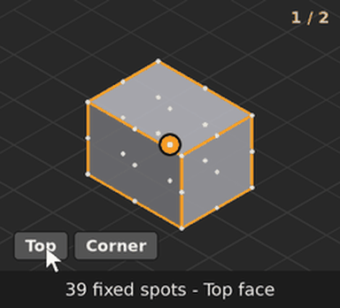
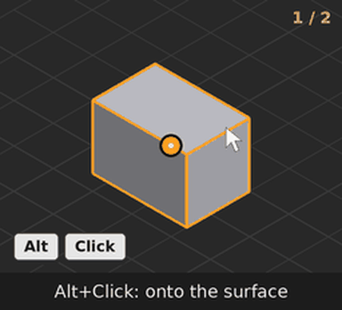
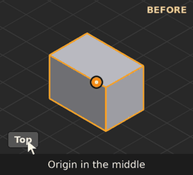
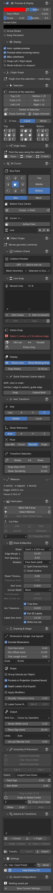
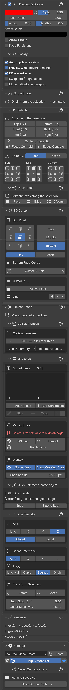
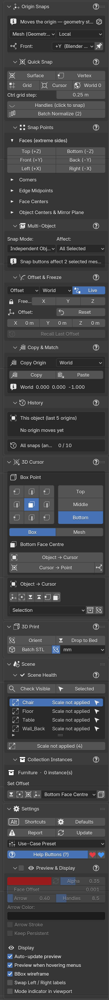
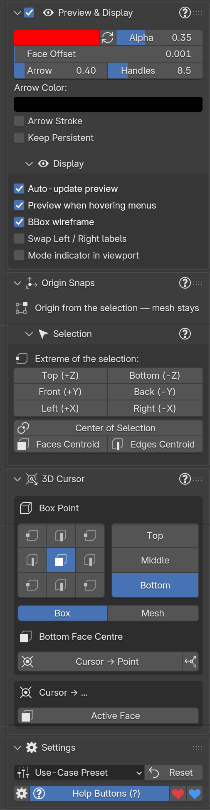
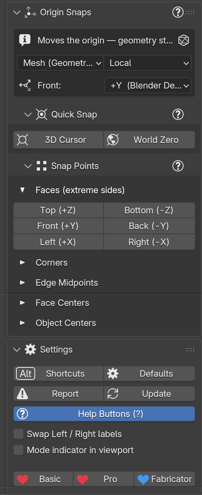
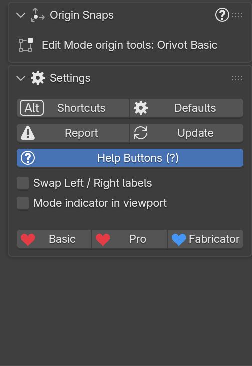

# Orivot Free

**Exact origin placement for Blender.** Snap an object's origin to 39 exact points: its extreme sides, corners, edge midpoints and face centres, or to its geometry, bounding-box or mass centre. One click, no Edit Mode, no 3D Cursor juggling. The geometry stays where it is.

Built for architecture, interiors and exhibition work, where an origin at the floor, a corner or a wall face is the difference between "snap into place" and "nudge for a minute".

<p align="center">
  
  
</p>

## Features

- **Snap Points:** the origin goes to any of 39 points on the object.
  - The six extreme sides: Top, Bottom, Left, Right, Front, Back.
  - The 8 corners.
  - The 12 edge midpoints.
  - The face centres.
  - The Geometry, Bounding-Box and Mass centres.
- **Snap Source:**
  - **Mesh** uses the real evaluated geometry, modifiers included. On a sphere, "Top" is the pole; on a roof, it is the ridge.
  - **Bounding Box** uses the object's box.
  - **3D Cursor** moves the origin to the cursor.
- **Local or Global orientation, and a Front axis.** "Front" and "Left" mean the object's own front, not just −Y.
- **Quick Snap:** the origin goes to the 3D Cursor or to World Zero.
- **Alt+Q pie menu** with configurable slots, plus **Object ▸ Set Origin to...** and right-click menu entries.
- **In-panel help:** a **?** on each panel plays a short animation of what it does.
- **Works on many objects at once:** every selected mesh gets its own origin snapped.
- **Greyed-out, not broken:** buttons that can't act on the selection (a curve, an empty, text) are greyed out, and their tooltip says why.

Everything lives in the **Orivot** tab of the 3D Viewport sidebar (N).

<p align="center"></p>

## Install

Requires **Blender 4.5 LTS or newer**. Tested on 4.5 LTS and 5.2 LTS.

1. Download `orivot_free-<version>.zip` from [Releases](../../releases). Don't unzip it.
2. In Blender, open **Edit ▸ Preferences ▸ Get Extensions**, then choose **⌄ ▸ Install from Disk...** and pick the zip.
3. Open the sidebar (N) in the 3D Viewport and go to the **Orivot** tab.

To install from source instead, zip the `orivot_free/` folder, or build it with Blender's extension tool:

```
blender --command extension build --source-dir orivot_free --output-dir .
```

## Editions

Orivot comes in four editions. Each one contains everything in the edition below it.

| | **Free** | **Basic** | **Pro** | **Fabricator** |
|---|:-:|:-:|:-:|:-:|
| 39 snap points, centres, 3D Cursor / World Zero, Alt+Q pie | ✔ | ✔ | ✔ | ✔ |
| Surface / vertex snapping, handles, Multi-Object, offsets, copy / paste | | ✔ | ✔ | ✔ |
| 3D Cursor panel: object to cursor, cursor to box points | | ✔ | ✔ | ✔ |
| 3D Print: orient, drop to bed, batch STL | | ✔ | ✔ | ✔ |
| Scene Health report, instance offsets, use-case presets | | ✔ | ✔ | ✔ |
| Object Snaps, Line Snap, Axis Transform, collision check | | | ✔ | ✔ |
| Measure: sizes, gaps, areas, volume, viewport dimensions | | | ✔ | ✔ |
| Grids & Levels, Clearances, Smart Distribute, Relations | | | ✔ | ✔ |
| Frames & Trusses, Site Rebase, Import Cleanup, Save as Asset | | | ✔ | ✔ |
| CNC cut files: nesting, kerf, dogbones, cut lists (DXF / SVG) | | | | ✔ |
| Drawings: plan / elevation / section with dimensions (DXF / SVG / PDF) | | | | ✔ |
| Schedules: areas, materials, lengths, board order (XLSX / CSV) | | | | ✔ |
| **Price** | free | AED 55 (~$15) | AED 145 (~$39)<br>launch **AED 125 (~$35)** | AED 239 (~$65)<br>launch **AED 185 (~$50)** |

Launch prices last until 31 Dec 2026. An upgrade costs the difference between the two prices. Owners of 4.2.5 Pro get Fabricator.

**To buy:** message on [Discord](https://discord.com/users/damagedarchitect). You pay with the Ziina payment link and the zip is delivered on Discord.

Install one edition at a time. They share tool names, so Blender refuses a second one with a message. Disable the one you have before you install another.

Orivot Pro adds object snapping, layout planning (grids, clearances, distribute, relations, frames) and live measuring; Orivot Fabricator adds drawings, schedules and CNC cut files. Both bring Edit Mode tools that make modelling faster and more precise.

### The sidebar of every edition

Every panel open, Object Mode and Edit Mode. Click an edition to see it.

<details>
<summary><b>Orivot Fabricator</b>: everything, including cut files, drawings and schedules</summary>

<table>
  <thead>
    <tr>
      <th width="50%">Object Mode</th>
      <th width="50%">Edit Mode</th>
    </tr>
  </thead>
  <tbody>
    <tr>
      <td valign="top"></td>
      <td valign="top"></td>
    </tr>
  </tbody>
</table>
</details>

<details>
<summary><b>Orivot Pro</b>: design and layout tools</summary>

<table>
  <thead>
    <tr>
      <th width="50%">Object Mode</th>
      <th width="50%">Edit Mode</th>
    </tr>
  </thead>
  <tbody>
    <tr>
      <td valign="top"></td>
      <td valign="top"></td>
    </tr>
  </tbody>
</table>
</details>

<details>
<summary><b>Orivot Basic</b>: snapping, handles, Multi-Object, 3D Cursor, 3D Print, Scene Health</summary>

<table>
  <thead>
    <tr>
      <th width="50%">Object Mode</th>
      <th width="50%">Edit Mode</th>
    </tr>
  </thead>
  <tbody>
    <tr>
      <td valign="top"></td>
      <td valign="top"></td>
    </tr>
  </tbody>
</table>
</details>

<details>
<summary><b>Orivot Free</b>: 39 snap points, Quick Snap, pie menu</summary>

<table>
  <thead>
    <tr>
      <th width="50%">Object Mode</th>
      <th width="50%">Edit Mode</th>
    </tr>
  </thead>
  <tbody>
    <tr>
      <td valign="top"></td>
      <td valign="top"></td>
    </tr>
  </tbody>
</table>
</details>

## Support

- Bugs and requests: [Issues](../../issues). Include your Blender version and the steps to reproduce.
- Contact: [Discord](https://discord.com/users/damagedarchitect) · cratercreativeconsultancy@gmail.com
- Author: **DaMagedArchitect**, Crater Creative Consultancy L.L.C., Abu Dhabi.

## Contributing

Bug reports and feature requests are welcome via [Issues](../../issues). Pull requests are reviewed, but large feature additions go to the paid editions; small fixes, documentation and compatibility patches are the most likely to be merged.

## License

[GPL-3.0-or-later](LICENSE), like Blender itself. © 2026 Crater Creative Consultancy L.L.C.
